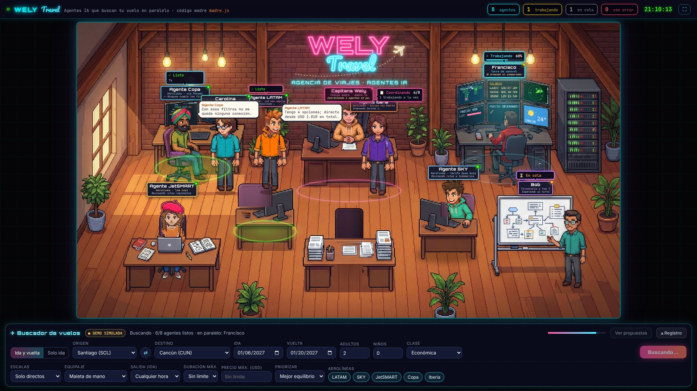
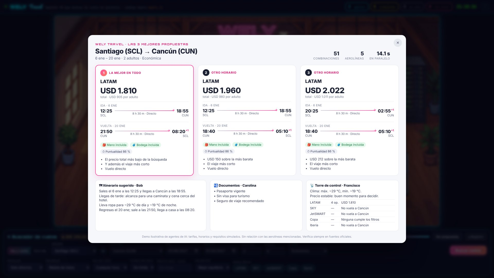

# ✈️ WELY Travel · Agentes IA que buscan tu vuelo

Una oficina de agentes de IA que buscan vuelos **en paralelo**, coordinados por un **código madre**.
Mientras trabajan conversan entre ellos y, al final, presentan **las 3 mejores propuestas**.



## Cómo funciona

- **Código madre** (`src/nucleo/madre.js`): recibe la búsqueda y lanza a cada agente en su propio hilo, en paralelo.
- **Agentes de aerolínea** (LATAM, SKY, JetSMART, Copa e Iberia): cada uno intenta primero el **sitio oficial**
  de su aerolínea (scraping con un navegador visible). Si el sitio bloquea o no se puede leer, busca esa
  aerolínea en **Google Flights vía [SerpApi](https://serpapi.com)**.
- **Francisco · Torre de control:** revisa todo el mercado en Google Flights, el nivel de precio y si **otra
  aerolínea** es mejor (la suma a la competencia).
- **Carolina · Documentos:** requisitos de entrada (orientativos).
- **Bob · Itinerario:** puntúa todos los vuelos y elige el **top 3** (mejor equilibrio, más económica, más rápida),
  con el vuelo de regreso y el enlace para reservar.



## Instalación (Windows, macOS o Linux)

Necesitas:
- [Node.js](https://nodejs.org) 18 o superior (versión LTS).
- Microsoft Edge o Google Chrome (para el scraping).
- Una clave gratis de [SerpApi](https://serpapi.com) (250 búsquedas al mes en el plan gratis).

```bash
git clone https://github.com/<usuario>/wely-travel.git
cd wely-travel
npm install
npm run real
```

La primera vez se crea el archivo **`.env`**: ábrelo, pega tu clave en `SERPAPI_KEY=` y vuelve a correr
`npm run real`. Se abre el centro de mando en **http://localhost:4173**: elige tu viaje y aprieta **Buscar vuelos**.

En Windows también puedes hacer doble clic en **`Abrir WELY Travel.bat`**.

Opciones del `.env`:

| Variable | Para qué |
|---|---|
| `SERPAPI_KEY` | Tu clave de SerpApi (obligatoria para el respaldo de Google Flights) |
| `SCRAPING=off` | Usar solo Google Flights, sin abrir ventanas del navegador |
| `NAVEGADOR=chrome` | Usar Chrome en vez de Edge |
| `CLP_POR_USD=950` | Tipo de cambio para los sitios que muestran pesos chilenos |

Repetir la misma búsqueda dentro de 6 horas no gasta consultas de SerpApi (se guarda en `.cache/`).

## Otros modos

- **Consola:** `node madre-cli.mjs --real --origen SCL --destino MAD --ida 2027-04-10 --vuelta 2027-04-24`
- **Demo sin conexión** (para publicar en un hosting estático): `npm run build` y subir la carpeta `dist/`.
  En ese modo los vuelos son simulados y la sala lo indica con **● DEMO SIMULADA**.

El detalle técnico (archivos, filtros, cómo busca cada sitio) está en [LEEME.md](LEEME.md).

## Uso responsable

- WELY Travel **no compra nada**: muestra opciones y enlaces para reservar en el sitio correspondiente.
- El scraping abre el sitio público de cada aerolínea con pocas consultas, sin esconder la automatización ni
  resolver captchas. Si un sitio la bloquea, se respeta y se usa Google Flights. Revisa los términos de uso de cada
  sitio; si prefieres no hacer scraping, usa `SCRAPING=off`.
- Los precios son los que muestran los sitios al momento de la búsqueda y pueden cambiar al reservar.
- No hay afiliación con las aerolíneas mencionadas.
- **Nunca subas tu `.env`**: está en `.gitignore` para que tu clave no se publique.

## Créditos

- Oficina en pixel-art: [OpenClaw Office](https://github.com/wickedapp/openclaw-office) (MIT, WickedApp), retocada
  (ver `LICENSE-OpenClaw-Office.txt`).
- Tipografías Orbitron, Inter, JetBrains Mono y Pacifico (SIL Open Font License).
